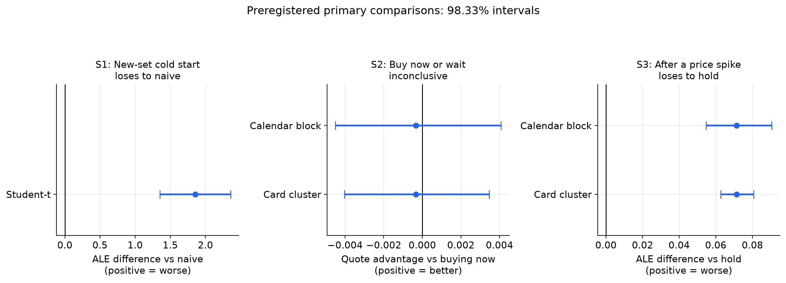
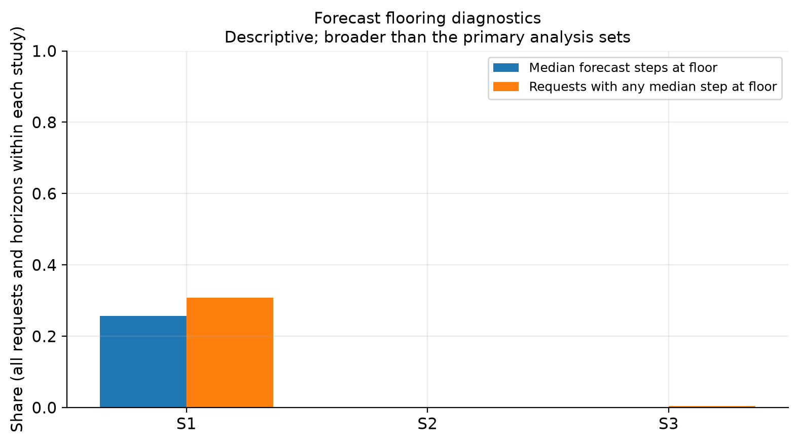

<!-- generated from docs/report.md.template by scripts/11_render_docs.py; do not edit -->

# TimesFM-3 on post-cutoff trading-card prices: a preregistered evaluation

This report is rendered from the evidence ledger (`results/evidence_ledger.json`): every number below is read from a committed results file, and `scripts/11_render_docs.py --check` rejects any number that is not. Verdicts are quoted exactly as the preregistered rules produced them.

## 1. Question and scope

**Question.** Does TimesFM-3, used zero-shot, forecast the daily marketplace price of Magic: The Gathering cards better than a naive last-value forecast on post-cutoff data? This is a statement about price series, not investment advice.

**Cutoff.** The pretraining cutoff of 2023-11-30 is a conservative reading of the model card, not a certified date. Claims here say "post-cutoff data" and never "unseen domain".

**Data.** TCGCSV daily archives from 2024-02-08 to the as-of date 2026-09-04. The checkpoint is `google/timesfm-3.0-pytorch`.

**Experiments.** A (primary): a rule-drawn pool of cards, TimesFM-3 against naive. B: market-shock event study, an exploratory red-team appendix. C: calibration of the P10-P90 interval and conformal recalibration. Covariates and latency are descriptive or small-cluster. Skill is one minus the ratio of the model's mean absolute error to the baseline's, so a positive skill means the model beats the baseline.

## 2. Design

Preregistration v2 (`docs/analysis-plan.md`) fixed the design before any model output of the evaluation existed. Intervals are two-sided at level 0.95, percentile bootstrap with B = 2000 resamples and seed 20261010. The primary interval resamples whole cards; the sensitivity interval is a synchronized calendar-block bootstrap (block length in days equal to the larger of the horizon and one week) and is conditional on this panel.

- **Pool.** 40 cards drawn by rule and frozen in a committed manifest before any model run (0 missing from the export). The 7 showcase cards were not forced in; none was drawn, so they are run separately and reported as descriptive only.
- **Primary cell.** TimesFM-3, univariate, raw prices, `make_positive`, context 512, origin stride 7. Primary horizons 28, 56; full grid 1, 7, 28, 56, 64; contexts 64, 128, 256, 512.
- **Verdict rule (stricter, adopted before any result was inspected).** "beats naive" needs all four intervals (cluster and calendar-block, for both median skill and n-weighted mean skill) entirely above zero; "loses to naive" needs all four entirely below zero; anything else is "inconclusive". The original primary-interval-only rule is reported as a labelled sensitivity.

Dated amendments to the preregistration, one line each:

- 10 Oct 2026: Experiment B's primary forecaster mode is univariate; multivariate is a sensitivity (before any data of the evaluation were seen).
- 10 Oct 2026: the stricter four-interval verdict rule above replaces the original one (human decision, before any result was seen).
- 10 Oct 2026 (items A-F, before any model run): pool eligibility clarified (A); self-check disclosure, including a DGP tuned after a preview (B); committed errors scaled per series (C); Experiment C regime offsets apply to the target day (D); forward-fill sensitivity mechanics (E); the frozen event rule produced 8 pre-cutoff and 7 post-cutoff events, too few to promote Experiment B (F).
- 11 Oct 2026: the TimesFM-2.5 grid computes only the naive baseline (before any TimesFM-2.5 output existed).
- 12 Oct 2026 (after the Kaggle runs): the preregistered MTG calibration split is empty by construction, so an exploratory post-hoc re-split is added and labelled as such (see Experiment C).

## 3. Experiment A: TimesFM-3 against naive (primary claim)

Each cell lists the point estimate, then the cluster interval, then the calendar-block interval.

| subset | h | verdict | median skill (cluster CI) (calendar CI) | n-weighted skill (cluster CI) (calendar CI) | cards |
|---|---|---|---|---|---|
| pool | 28 | **inconclusive** | -0.015 [-0.057, 0.020] [-0.054, -0.001] | -0.036 [-0.066, -0.005] [-0.079, -0.024] | 40 |
| pool | 56 | **loses to naive** | -0.040 [-0.087, -0.002] [-0.073, -0.005] | -0.082 [-0.141, -0.028] [-0.172, -0.067] | 40 |
| pool without showcase cards | 28 | **inconclusive** | -0.015 [-0.057, 0.020] [-0.054, -0.001] | -0.036 [-0.066, -0.005] [-0.079, -0.024] | 40 |
| pool without showcase cards | 56 | **loses to naive** | -0.040 [-0.087, -0.002] [-0.073, -0.005] | -0.082 [-0.141, -0.028] [-0.172, -0.067] | 40 |
| showcase only (descriptive) | 28 | **descriptive (no verdict)** | -0.034 [-0.045, 0.025] [-0.076, 0.051] | -0.006 [-0.034, 0.029] [-0.072, 0.050] | 7 |
| showcase only (descriptive) | 56 | **descriptive (no verdict)** | -0.007 [-0.078, 0.054] [-0.102, 0.081] | 0.006 [-0.046, 0.058] [-0.092, 0.084] | 7 |

**Verdicts on the pool.** At h = 28: **inconclusive**. At h = 56: **loses to naive**. These strings are the rule's output. "inconclusive" means at least one of the four intervals does not lie entirely on one side of zero, and no claim of beating or losing is made. "loses to naive" is reported as it stands. The sensitivity with the original primary-interval-only rule gives inconclusive at h = 28 and loses to naive at h = 56. The showcase-only subset has 7 cards and is descriptive: its verdict column reads "descriptive (no verdict)".

**Secondary results (descriptive, no verdict).** Point estimates of skill against the stated reference for variants of the primary cell; none is a decision input and none carries a multiplicity correction.

| variant | reference | h = 28 median | h = 28 n-weighted | h = 56 median | h = 56 n-weighted | cards |
|---|---|---|---|---|---|---|
| primary cell | naive | -0.015 | -0.036 | -0.040 | -0.082 | 40 |
| primary cell | seasonal naive | -0.015 | -0.036 | -0.040 | -0.082 | 40 |
| primary cell | drift | 0.045 | 0.036 | 0.006 | -0.021 | 40 |
| primary cell | ETS | 0.042 | 0.037 | 0.064 | 0.015 | 40 |
| context 64 | naive | -0.132 | -0.140 | -0.144 | -0.145 | 40 |
| context 128 | naive | -0.112 | -0.098 | -0.172 | -0.128 | 40 |
| context 256 | naive | -0.040 | -0.045 | -0.068 | -0.074 | 40 |
| log1p transform | naive | -0.015 | -0.028 | -0.029 | -0.062 | 40 |
| `make_positive` off | naive | -0.015 | -0.036 | -0.040 | -0.082 | 40 |
| multivariate | naive | -0.008 | -0.016 | -0.038 | -0.047 | 40 |
| multivariate, placebo panel | naive | -0.018 | -0.028 | -0.043 | -0.057 | 7 |
| TimesFM-2.5 univariate (model comparison only) | naive | -0.019 | -0.013 | -0.017 | -0.027 | 40 |

Seasonal naive coincides with naive at every horizon that is a multiple of the season length (7), so those two rows are identical by construction. The multivariate, univariate and placebo rows are separate skills against naive, not paired differences, and carry no interval here. The context rows use the context lengths of the grid, and the placebo row is computed on the 7-card placebo panel (seed 42), not on the full pool, so it is not directly comparable with the other rows. The log1p variant against naive has a cluster interval of [-0.046, 0.018] (median) at h = 28 and [-0.086, 0.006] at h = 56. TimesFM-2.5 is compared with TimesFM-3 as a model comparison only: no TimesFM-2.5 cutoff is sourced, so it is never a cutoff control.

**Per-card Diebold-Mariano tests (secondary).** For the primary cell against naive, each comparison family has 200 card-by-horizon tests. Rejections of equal accuracy (two-sided, no direction implied): at h = 28, 3 by Benjamini-Hochberg (primary) and 0 by Benjamini-Yekutieli (sensitivity); at h = 56, 1 and 0. These counts never override the aggregate intervals.

**Forward-fill sensitivity is uninformative.** The exports that forward-fill at most 0 and at most 1 days give a skill difference from the primary export of 0.000 (interval [0.000, 0.000]) and 0.000 (interval [0.000, 0.000]). That is not evidence of robustness: the only non-observed day is 2026-09-04, the as-of day whose archive was unavailable (1 day), and it lies outside every context window, so the sensitivity cannot change any forecast.

## 4. Experiment C: calibration of the P10-P90 interval

The nominal coverage of a P10-P90 interval is 0.80. A regime **under-covers** when the upper bound of its calendar-block interval lies below nominal. Regimes: `mtg` (the Experiment A primary cell), `market_shock` (target day near a shock onset) and `event_window_nonshock` (non-shock days inside event windows, not a general calm sample). All results are empirical subgroup evaluations, not conformal guarantees.

| regime | h | coverage | calendar-block CI | cluster CI | rows | clusters | under-covers |
|---|---|---|---|---|---|---|---|
| mtg | 1 | 0.825 | [0.809, 0.842] | [0.794, 0.855] | 2120 | 40 | false |
| mtg | 7 | 0.777 | [0.761, 0.794] | [0.752, 0.803] | 2120 | 40 | true |
| mtg | 28 | 0.721 | [0.698, 0.745] | [0.683, 0.759] | 2120 | 40 | true |
| mtg | 56 | 0.696 | [0.657, 0.731] | [0.646, 0.745] | 2120 | 40 | true |
| market_shock | 1 | 0.667 | [0.603, 0.733] | [0.600, 0.733] | 105 | 15 | true |
| market_shock | 7 | 0.438 | [0.305, 0.563] | [0.324, 0.533] | 105 | 15 | true |
| market_shock | 28 | n/a | [n/a, n/a] | [n/a, n/a] | 0 | 0 | false |
| event_window_nonshock | 1 | 0.780 | [0.741, 0.818] | [0.738, 0.822] | 450 | 15 | false |
| event_window_nonshock | 7 | 0.764 | [0.694, 0.827] | [0.691, 0.831] | 450 | 15 | false |
| event_window_nonshock | 28 | 0.650 | [0.533, 0.762] | [0.501, 0.795] | 555 | 15 | true |

Cells with zero rows are not evaluable and show n/a (their under-covers flag is false only because there is nothing to evaluate). A row marked true under-covers by the preregistered rule. The market regimes have 15 event clusters, so they are small-cluster results.

**Preregistered MTG conformal fix: not evaluable as preregistered.** The preregistered calibration split (origins and targets before 2025-06-01) holds 0 rows by construction, status `no_calibration_rows`: with context 512 the first feasible origin falls after the split date. No "conformal fixes it" verdict exists for MTG under the preregistration.

**Market conformal, as preregistered** (calibration on pre-cutoff events, evaluation on post-cutoff events; "fixes it" means the post-recalibration calendar-block interval contains nominal coverage).

| regime | h | coverage before | coverage after (calendar-block CI) | fixes it | median relative width increase | calibration rows | evaluation rows |
|---|---|---|---|---|---|---|---|
| market_shock | 1 | 0.694 | 0.714 [0.623, 0.808] | true | 0.086 | 296 | 49 |
| market_shock | 7 | 0.531 | 0.673 [0.475, 0.848] | true | 0.437 | 296 | 49 |
| market_shock | 28 | n/a | n/a [n/a, n/a] | n/a | n/a | 296 | 0 |
| event_window_nonshock | 1 | 0.752 | 0.786 [0.727, 0.839] | true | 0.100 | 296 | 210 |
| event_window_nonshock | 7 | 0.781 | 0.924 [0.872, 0.965] | false | 0.383 | 296 | 210 |
| event_window_nonshock | 28 | 0.788 | 0.946 [0.876, 0.996] | false | 0.540 | 296 | 259 |

The rule is satisfied for some cells partly because the post-recalibration interval is wide: `market_shock` at h = 1 (fixes it: true; calendar-block CI [0.623, 0.808]); `market_shock` at h = 7 (fixes it: true; calendar-block CI [0.475, 0.848]); `event_window_nonshock` at h = 1 (fixes it: true; calendar-block CI [0.727, 0.839]). A calendar-block CI that contains the nominal level shows compatibility with it, not that calibration was restored.

The `market_shock` cell at h = 28 has 0 evaluation rows and is not evaluable; its "fixes it" entry is n/a, never "no".

### Exploratory MTG analysis - post-hoc amended split

This section is exploratory and post hoc (amendment of 12 Oct 2026). Calibration rows have origin and target before 2026-01-02, the median distinct origin date; evaluation rows are the origins on or after it. The rule was fixed before any recalibrated MTG number was computed, but after the uncalibrated coverage and the Experiment A verdicts had been seen, so no blindness to outcomes is claimed. Before and after are computed on exactly the same evaluation rows. It is not the preregistered verdict.

| h | coverage before (calendar-block CI) | under-covered before | coverage after (calendar-block CI) | fixes it | median relative width increase | calibration rows | evaluation rows |
|---|---|---|---|---|---|---|---|
| 1 | 0.807 [0.781, 0.831] | false | 0.781 [0.757, 0.803] | true | -0.100 | 1040 | 1080 |
| 7 | 0.772 [0.748, 0.795] | true | 0.783 [0.758, 0.807] | true | 0.077 | 1040 | 1080 |
| 28 | 0.694 [0.671, 0.716] | true | 0.731 [0.705, 0.756] | false | 0.090 | 920 | 1080 |
| 56 | 0.672 [0.645, 0.698] | true | 0.714 [0.685, 0.743] | false | 0.102 | 760 | 1080 |

At h = 7 the entry is true with calendar-block CI [0.758, 0.807]. A CI containing the nominal level shows compatibility with it, not that calibration was restored.

At h = 1 the evaluation split was not under-covering before recalibration (flag above), so a "fixes it" entry there says little about the recalibration. Where "fixes it" is false, the recalibrated interval still does not reach nominal coverage. Label: empirical subgroup evaluation, not a conformal guarantee.

## 5. Experiment B: exploratory red-team appendix

Experiment B is an explicitly **exploratory red-team appendix**, not a result of the main claim. The frozen rule (shock day: absolute z-score at least 4.0 against a trailing window of 250 trading days; events within 20 trading days merged; guard band between 2023-05-31 and 2024-06-01 excluded) produced 8 pre-cutoff and 7 post-cutoff events. **Promotion verdict: appendix.** Reasons recorded with the verdict: fewer than 8 events per arm (pre=8, post=7); primary CI does not exclude 0.

The primary statistic is the difference, post minus pre, of the error-recovery lag of TimesFM-3 relative to naive (restricted mean, event-cluster bootstrap). Descriptive effects at the primary threshold:

| forecaster and perturbation | lag difference vs naive (CI) | anticipation hit-rate difference (CI) | events pre / post |
|---|---|---|---|
| TimesFM-3 univariate, none | -3.054 [-11.500, 4.696] | -0.193 [-0.568, 0.197] | 8 / 7 |
| TimesFM-3 univariate, noise | -3.568 [-9.397, 2.466] | -0.149 [-0.451, 0.179] | 8 / 7 |
| TimesFM-3 univariate, context splice | -5.686 [-10.601, -1.799] | 0.109 [-0.137, 0.354] | 7 / 7 |
| TimesFM-2.5 univariate, none (model comparison only) | -3.857 [-8.179, -0.750] | -0.107 [-0.493, 0.314] | 8 / 7 |

Promotion requires all of: enough events per arm, a primary interval that excludes zero, and a same-sign effect under both perturbations; the recorded reasons above state which condition failed. Perturbation and TimesFM-2.5 rows are descriptive: a row whose interval excludes zero does not change the promotion verdict, which the rule decides on the unperturbed primary effect. Both arms are small clusters, so no claim about faster or slower adaptation after a shock is made.

## 6. Covariates

A covariate "helps" only if the paired skill-delta interval lies above zero against both the no-covariate arm and the placebo arm. Context 128, origin stride 7, B = 2000. Rows show the primary statistic (n-weighted skill difference); the first horizon is the primary one, "all" pools horizons and is descriptive.

| domain | comparison | horizon | skill difference (CI) | verdict | clusters | label |
|---|---|---|---|---|---|---|
| mtg | legit vs no covariate | primary | 0.003 [-0.007, 0.013] | **inconclusive** | 40 |  |
| mtg | legit vs no covariate | all | 0.005 [-0.004, 0.014] | **inconclusive** | 40 |  |
| mtg | legit vs placebo | primary | 0.002 [-0.003, 0.008] | **inconclusive** | 40 |  |
| mtg | legit vs placebo | all | -0.002 [-0.007, 0.003] | **inconclusive** | 40 |  |
| market | legit vs no covariate | primary | 0.014 [-0.003, 0.030] | **inconclusive** | 2 | small-cluster/exploratory |
| market | legit vs no covariate | all | 0.015 [0.006, 0.024] | **inconclusive** | 2 | small-cluster/exploratory |
| market | legit vs placebo | primary | 0.001 [-0.003, 0.005] | **inconclusive** | 2 | small-cluster/exploratory |
| market | legit vs placebo | all | 0.002 [-0.001, 0.006] | **inconclusive** | 2 | small-cluster/exploratory |

Every verdict above is quoted from the ledger; where it reads "inconclusive", no helping effect is claimed. For the market domain the all-horizon legitimate-versus-no-covariate interval lies above zero, but the legitimate-versus-placebo interval does not, so the rule's verdict is inconclusive. The market domain rests on 2 clusters and is small-cluster/exploratory.

**Leakage demonstration.** A leaked arm that sees real future values is a teaching contrast, watermarked "LEAKED - teaching contrast, not a result", and is excluded from every summary and headline. It shows why a covariate must be known at forecast time; it is not a result and no number from it is reported here.

## 7. Latency

Descriptive only: seconds per 1000 forecasts, median and 95th percentile, on `Tesla T4` for the model and on CPU for the baselines (20 repeats after 3 warmups). Context 512, horizon 28.

| method | batch | median | 95th percentile |
|---|---|---|---|
| TimesFM-3 | 1 | 144.1487 | 176.5635 |
| TimesFM-3 | 8 | 21.3619 | 21.7625 |
| TimesFM-3 | 32 | 16.0224 | 16.5155 |
| TimesFM-3 | 128 | 15.7492 | 15.9691 |
| ETS (CPU) | 128 | 36.0162 | 38.2850 |
| naive (CPU) | 128 | 0.0029 | 0.0032 |
| TimesFM-2.5 | 128 | 9.0389 | 9.3919 |

These timings are not a deployment recommendation: the checkpoint licence is non-commercial, and no cost figure is given.

## 8. Statistical self-check

Before real data, the primary interval was checked on simulated panels with known skill (400 datasets per cluster count). Acceptance used the baseline scenario at 40 clusters: coverage of the nominal 0.95 interval within [0.92, 0.98]; result: **PASS**. The baseline constants were chosen after a preview that showed under-coverage (amendment B), which is disclosed rather than hidden. Cluster counts below the acceptance count are reported but never used for acceptance.

| scenario | clusters | median coverage (MC CI) | n-weighted coverage (MC CI) |
|---|---|---|---|
| baseline | 8 | 0.945 [0.918, 0.963] | 0.892 [0.858, 0.919] |
| baseline | 20 | 0.925 [0.895, 0.947] | 0.910 [0.878, 0.934] |
| baseline | 40 | 0.945 [0.918, 0.963] | 0.935 [0.906, 0.955] |
| stress | 8 | 0.868 [0.831, 0.897] | 0.790 [0.747, 0.827] |
| stress | 20 | 0.818 [0.777, 0.852] | 0.810 [0.769, 0.845] |
| stress | 40 | 0.755 [0.711, 0.795] | 0.725 [0.679, 0.766] |

The stress scenario (strong common shocks across clusters) is a sensitivity and is never used for acceptance. Under it the cluster interval covers less than nominal at 40 clusters, which is why the verdict rule also requires the calendar-block interval to agree. Reading: a cluster interval that excludes zero is weaker evidence than its nominal level suggests when cards share common shocks, and the stricter rule exists for that reason.

## Decision-focused studies (Preregistration v3)

The follow-up [preregistration](analysis-plan-v3.md) asks whether the same model is useful for new-set cold starts, purchase timing, or forecasting after a price spike. These are retrospective studies of marketplace quotes with an as-of cutoff of 2026-09-04, using checkpoint revision `43046b85ec22d584a13f8098c2ed39c889e129c2`. The catalogue was fetched after the as-of date; it is not a point-in-time catalogue. Each study uses origin-available histories and the frozen selection rules. Status: S1 **complete**, S2 **complete**, S3 **complete**.

The confirmatory family contains the three primary comparisons. Bonferroni-adjusted two-sided interval level is 0.983333. Bootstrap comparisons use 2000 resamples and seed 20261010. The cold-start verdict requires agreement between its event-level Student-t interval and sign-flip test. Purchase timing and spike verdicts require agreement between card-cluster and calendar-block intervals. Absolute log error (ALE) is the absolute log ratio of forecast to outcome: a positive model-minus-reference difference means greater error. Quote advantage is one minus the execution quote divided by the origin quote: positive means a lower quote than buying now.

| study | primary estimand | estimate | primary interval | calendar-block interval | analysis units | verdict |
|---|---|---|---|---|---|---|
| S1: new-set cold start | event mean ALE difference vs naive | 1.8530 | [1.3495, 2.3564] (Student-t) | not used | 20 release events | **loses to naive** |
| S2: buy now or wait | mean quote advantage vs buying now | -0.0003 | [-0.0040, 0.0035] (card cluster) | [-0.0045, 0.0041] | 5325 decisions | **inconclusive** |
| S3: spike, hold or revert | mean ALE difference vs hold | 0.0714 | [0.0627, 0.0807] (card cluster) | [0.0546, 0.0905] | 13263 events | **loses to hold** |

**New-set cold start.** The primary forecast starts 14 days after release and predicts the quote 90 days after release, with a primary origin-quote eligibility floor of $1.00. The paired analysis includes 9471 SKUs across 20 release events, with 17 missing outcomes and 0 unavailable forecasts at the primary eligibility floor. The sign-flip p-value is 0.00000191. The positive ALE difference means that extrapolating the early price history performed worse than keeping the origin quote fixed. Events, rather than individual SKUs, are the primary averaging units.

**Buy now or wait.** The model chooses an execution day within 28 days by minimizing its predicted median path, including the option to buy immediately. The estimate is close to zero, and both intervals cross zero: **inconclusive**. This does not establish equivalence with buying now. Failed executions count against the policy under the preregistered rule. The estimand is a quote-based price advantage; it does not account for fees, shipping, stock, or the ability to transact at that quote.

**Spike, hold or revert.** The census met the preregistered event-count and calendar-span requirements, so the primary comparison is confirmatory. At the primary horizon of 28 days, the model has greater ALE than holding the spike-day quote fixed: **loses to hold**. This compares forecast errors; it is not a recommendation to hold an asset. Missing outcomes are excluded on the same paired set for every forecasting method.

### Forecast-floor diagnostics and exploratory sensitivity

Amendment A1 was committed after inspecting forecasts but before computing outcomes. It sorts quantiles after applying the preregistered numerical floor (0.001 times the origin quote), and retains the median after sorting. The flooring diagnostics below cover all requests and forecast steps in each study, including secondary horizons and eligibility floors; their denominators differ from the primary analysis sets above.

| study | requests | share of median forecast steps at floor | share of requests with any median step at floor |
|---|---|---|---|
| S1 | 45823 | 0.256792 | 0.307815 |
| S2 | 5325 | 0.000007 | 0.000188 |
| S3 | 13275 | 0.001766 | 0.003917 |

Flooring is especially common in the cold-start study, where the model can extrapolate an early decline to zero. The pre-declared exploratory check restricts the primary cold-start sample to median paths that never hit the floor: 6757 paired SKUs across 20 events. Its mean ALE difference remains positive at 0.1610, with exploratory interval [0.1041, 0.2179] at level 0.95. This is a selected subset of forecasts, not a causal estimate of the floor's effect, and does not replace the primary verdict. Exploratory central-interval coverage (nominal 0.80) for the cold-start study is 0.5684; no coverage confidence interval is supplied, so no calibration verdict is made here.

The new studies provide no confirmatory evidence of an advantage for the model in these tasks. This conclusion is limited to the frozen samples, checkpoint, inference settings, and quote-based outcomes. Other baseline comparisons, price-band splits, and secondary horizons remain exploratory; see the committed study summaries for details.

## 9. Limitations and threats to validity

- The cutoff is a conservative reading; contamination on either side cannot be excluded, and TimesFM-2.5 has no sourced cutoff.
- One marketplace source; prices are marketplace quotes, not transactions. The catalog was fetched after the as-of date. The as-of day itself is missing.
- Cards share common shocks (set releases, bans, market-wide moves), so effective sample size is smaller than the card count; the calendar-block interval and the stress scenario address this only partly.
- Experiment B has few events per arm and is an exploratory appendix. The covariate arms are small-cluster in the market domain. The placebo panel is a small subset.
- The preregistered MTG conformal test could not be run; the re-split is post hoc and exploratory, fixed after the uncalibrated coverage and verdicts had been seen.
- Secondary comparisons are descriptive, uncorrected for multiplicity, and cannot change a verdict.
- Committed errors are scaled per series; skill ratios are exact, pooled skill is level-free and secondary.
- Latency is one GPU, one environment. Nothing here is investment advice or a deployment recommendation.

## 10. Reproducibility

Every step is a script under `scripts/`; GPU steps run through `notebooks/run_on_kaggle.ipynb` as described in `docs/kaggle-runbook.md`. Each run writes a manifest under `results/manifests/` (git SHA, preregistration commit, as-of date, checkpoint revision, seed, environment). `scripts/10_evidence_ledger.py` builds `results/evidence_ledger.json` and `docs/evidence-ledger.md` from the committed results, checking each file's sha256 against a manifest. This report is rendered from `docs/report.md.template` by `scripts/11_render_docs.py`; its `--check` re-renders in memory, compares byte for byte and rejects any number without a ledger claim. Frozen pool: `configs/benchmark_pool_v2.csv`. Self-check design: `docs/inference-selfcheck.md`. Committed outputs hold normalized errors and values only; actual prices stay in the local Kaggle archive.
