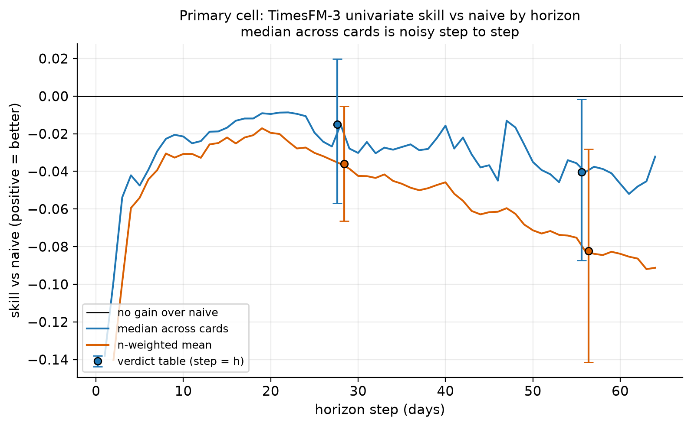
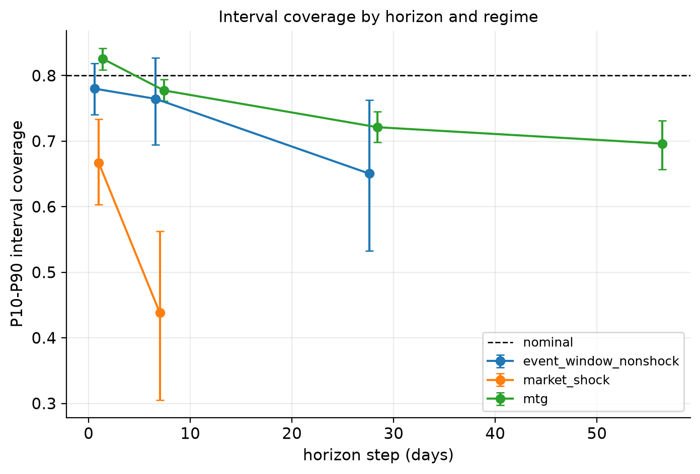
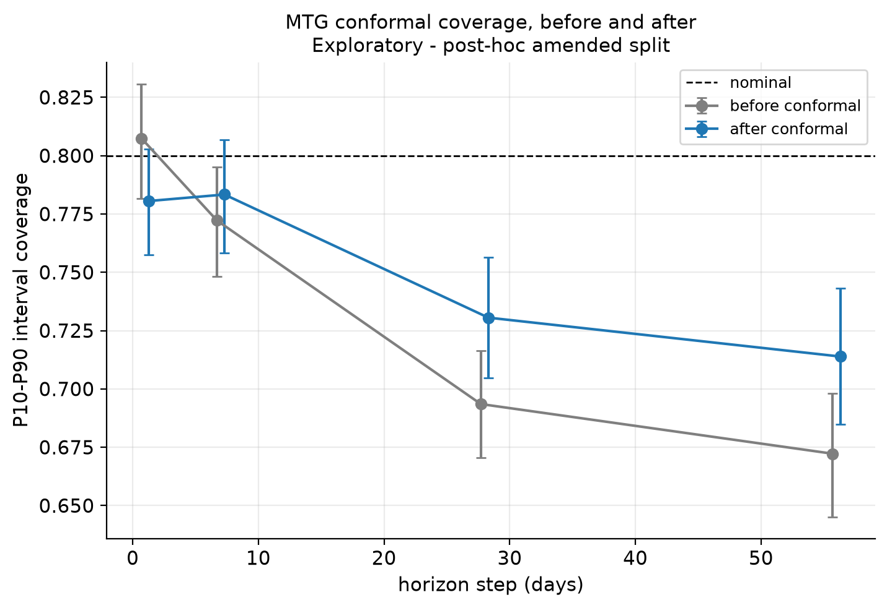
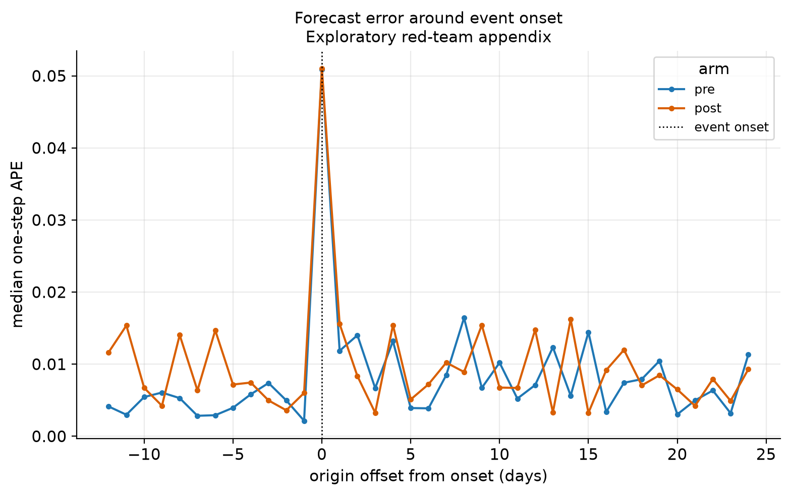
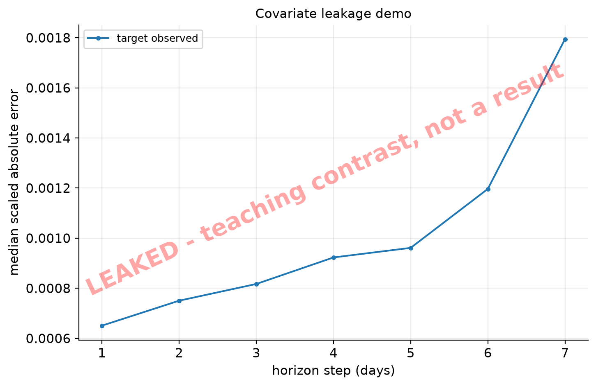
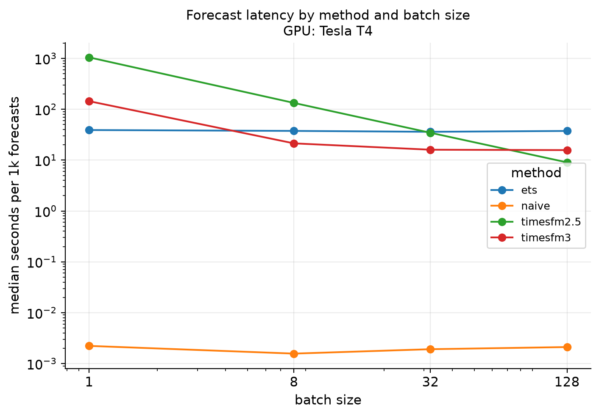

<!-- generated from slides/talk.md.template by scripts/11_render_docs.py; do not edit -->

<!-- _paginate: false -->
# TimesFM-3 su prezzi di carte collezionabili: una valutazione preregistrata

Un foundation model per serie temporali, usato zero-shot, contro il naive su **dati post-cutoff**.

Ogni numero di queste slide è letto dal registro delle evidenze (ledger), non scritto a mano.

---

## Domanda e perimetro

- **Domanda.** TimesFM-3, zero-shot, prevede il prezzo giornaliero di mercato delle carte Magic: The Gathering meglio di una previsione naive (ultimo valore)?
- Parliamo di serie di prezzi, **non di consigli di investimento**.
- Cutoff di pretraining: 2023-11-30, una lettura prudente della model card, non una data certificata.
- Diciamo sempre **dati post-cutoff**: non possiamo certificare che il dominio sia "mai visto".
- Skill = uno meno il rapporto fra MAE del modello e MAE del baseline: skill positiva significa che il modello batte il baseline.

---

## Cosa abbiamo misurato

- **A (primario).** Pool di carte estratto con una regola: TimesFM-3 contro naive.
- **C.** Calibrazione dell'intervallo P10-P90 e ricalibrazione conforme.
- **B (appendice, esplorativo).** Studio degli shock di mercato come red-team.
- **Covariate** e **latenza**: descrittive o su pochi cluster.
- Dati: archivi giornalieri TCGCSV da 2024-02-08 alla data di riferimento 2026-09-04.
- Checkpoint: `google/timesfm-3.0-pytorch`.

---

## Preregistrazione e regola più severa

- Il disegno (`docs/analysis-plan.md`) è fissato **prima** di ogni output del modello sulla valutazione; gli emendamenti sono datati e stanno nel piano.
- Pool: 40 carte estratte per regola e congelate in un manifest (0 assenti dall'export).
- Intervalli bootstrap percentile al livello 0.95, con B = 2000 ricampionamenti.
- **"beats naive"** richiede quattro intervalli (cluster e blocchi di calendario, per mediana e media pesata) tutti sopra zero; **"loses to naive"** tutti sotto zero; altrimenti **"inconclusive"**.
- La regola più severa è stata adottata prima di vedere qualunque risultato; la regola originale resta come sensibilità etichettata.

---

## Esperimento A: i verdetti (claim primario)

Verdetti della regola, citati alla lettera dal ledger:

| h | verdetto | skill mediana (IC cluster) (IC calendario) | carte |
|---|---|---|---|
| 28 | **"inconclusive"** | -0.015 [-0.057, 0.020] [-0.054, -0.001] | 40 |
| 56 | **"loses to naive"** | -0.040 [-0.087, -0.002] [-0.073, -0.005] | 40 |

- Con le stringhe inglesi della regola: "inconclusive" = almeno uno dei quattro intervalli non sta tutto da un lato dello zero, quindi **nessuna affermazione** di vittoria o sconfitta.
- "loses to naive" = il modello perde contro il naive, e lo riportiamo così com'è.

---

## Esperimento A: sensibilità e sottoinsiemi

- Regola originale (solo intervallo primario), come sensibilità: "inconclusive" a h = 28 e "loses to naive" a h = 56.
- Pool senza carte showcase: "inconclusive" (h = 28) e "loses to naive" (h = 56).
- Solo carte showcase (descrittivo): 7 carte, colonna verdetto "descriptive (no verdict)". Nessuna è stata estratta dal pool, quindi sono eseguite a parte.

---

## Esperimento A: risultati secondari (descrittivi)

descrittivo: stime puntuali di skill, nessun verdetto, nessuna correzione per molteplicità.

| variante | riferimento | mediana h = 28 | mediana h = 56 |
|---|---|---|---|
| cella primaria | naive | -0.015 | -0.040 |
| cella primaria | drift | 0.045 | 0.006 |
| cella primaria | ETS | 0.042 | 0.064 |
| multivariato | naive | -0.008 | -0.038 |
| TimesFM-2.5 (solo confronto fra modelli) | naive | -0.019 | -0.017 |

Il naive stagionale coincide col naive agli orizzonti multipli della stagionalità: righe identiche per costruzione. Per TimesFM-2.5 non c'è un cutoff documentato, quindi non è un controllo sul cutoff.

---

## Esperimento A: test per carta e forward-fill

- Test Diebold-Mariano per carta (descrittivo, bilaterali, senza direzione): rifiuti con Benjamini-Hochberg (primario) 3 a h = 28 e 1 a h = 56. Non scavalcano gli intervalli aggregati.
- **La sensibilità al forward-fill è non informativa.** L'unico giorno non osservato è 2026-09-04 (1 giorno, data di riferimento) e sta fuori da ogni finestra di contesto: non può cambiare alcuna previsione. Non è una prova di robustezza.

---

## Esperimento A: skill per orizzonte

---

## Esperimento C: calibrazione dell'intervallo P10-P90

Copertura nominale: 0.80. Un regime **sotto-copre** se il limite superiore dell'IC a blocchi di calendario sta sotto il nominale.

| regime | h | copertura | IC calendario | sotto-copre |
|---|---|---|---|---|
| mtg | 1 | 0.825 | [0.809, 0.842] | false |
| mtg | 7 | 0.777 | [0.761, 0.794] | true |
| mtg | 28 | 0.721 | [0.698, 0.745] | true |
| mtg | 56 | 0.696 | [0.657, 0.731] | true |

Valutazioni empiriche di sottogruppo, non garanzie conformi. I regimi di mercato (shock, finestre senza shock) hanno pochi cluster: risultati su piccoli cluster.

---

## Esperimento C: copertura per regime

---

## Conforme su MTG: non valutabile come preregistrato

- Lo split di calibrazione preregistrato (origini e target prima di 2025-06-01) contiene 0 righe **per costruzione**, stato `no_calibration_rows`.
- Con contesto 512 la prima origine fattibile cade dopo la data di split.
- **Non esiste alcun verdetto "il conforme lo risolve" per MTG** sotto la preregistrazione.
- Conforme sul mercato, come preregistrato: l'IC a blocchi che contiene il nominale mostra **compatibilità**, non che la calibrazione sia stata ripristinata; in diverse celle l'intervallo ricalibrato è semplicemente largo.

---

## Esplorativo - split post-hoc

Esplorativo - split post-hoc: non è il verdetto preregistrato. Regola fissata prima di calcolare i numeri ricalibrati, ma dopo aver visto copertura non calibrata e verdetti dell'Esperimento A: nessuna cecità sugli esiti.

| h | prima (IC calendario) | dopo (IC calendario) | "fixes it" | righe cal. / val. |
|---|---|---|---|---|
| 1 | 0.807 [0.781, 0.831] | 0.781 [0.757, 0.803] | true | 1040 / 1080 |
| 7 | 0.772 [0.748, 0.795] | 0.783 [0.758, 0.807] | true | 1040 / 1080 |
| 28 | 0.694 [0.671, 0.716] | 0.731 [0.705, 0.756] | false | 920 / 1080 |
| 56 | 0.672 [0.645, 0.698] | 0.714 [0.685, 0.743] | false | 760 / 1080 |

Dove "fixes it" è false, l'intervallo ricalibrato non raggiunge comunque il nominale. A h = 1 lo split di valutazione non sotto-copriva già prima: lì il risultato dice poco.

---

## Esplorativo - split post-hoc: figura

---

## Appendice - Esperimento B: red-team sugli shock (esplorativo)

Non è un risultato del claim principale. Regola congelata: |z| almeno 4.0 su una finestra mobile di 250 giorni di borsa, eventi ravvicinati fusi.

- Eventi: 8 pre-cutoff e 7 post-cutoff.
- **Verdetto di promozione: "appendix"**.
- Motivi registrati col verdetto: fewer than 8 events per arm (pre=8, post=7); primary CI does not exclude 0.
- Pochi eventi per braccio: **nessuna affermazione** su adattamento più rapido o più lento dopo uno shock. Le perturbazioni e TimesFM-2.5 sono descrittive.

---

## Appendice - Esperimento B: errore attorno allo shock

---

## Covariate: servono davvero?

Una covariata "aiuta" solo se l'IC della differenza di skill sta sopra zero contro **entrambi** i bracci: nessuna covariata e placebo.

| dominio | confronto | orizzonte | differenza (IC) | verdetto |
|---|---|---|---|---|
| mtg | legit vs nessuna | primario | 0.003 [-0.007, 0.013] | "inconclusive" |
| mtg | legit vs placebo | primario | 0.002 [-0.003, 0.008] | "inconclusive" |
| mercato | legit vs nessuna | tutti (descrittivo) | 0.015 [0.006, 0.024] | "inconclusive" |
| mercato | legit vs placebo | tutti (descrittivo) | 0.002 [-0.001, 0.006] | "inconclusive" |

Mercato: 2 cluster, piccoli cluster / esplorativo. Dove il verdetto è "inconclusive" non si afferma alcun effetto.

---

## LEAKED: un contrasto didattico

LEAKED - teaching contrast, not a result

- Un braccio che vede valori futuri reali serve a insegnare perché una covariata deve essere nota al momento della previsione.
- **Non è un risultato**: è escluso da ogni sintesi e da ogni titolo, e su questa slide non c'è alcun numero.

---

## Latenza (descrittiva)

Secondi per mille previsioni, mediana e 95° percentile, su `Tesla T4` per il modello e CPU per i baseline. Contesto 512, orizzonte 28.

| metodo | batch | mediana | 95° percentile |
|---|---|---|---|
| TimesFM-3 | 1 | 144.1487 | 176.5635 |
| TimesFM-3 | 128 | 15.7492 | 15.9691 |
| ETS (CPU) | 128 | 36.0162 | 38.2850 |
| naive (CPU) | 128 | 0.0029 | 0.0032 |

Una GPU, un ambiente. **Non è una raccomandazione di deploy**: la licenza del checkpoint è non commerciale e non diamo alcun costo.

---

## Latenza: figura

---

## Cosa abbiamo imparato

- Su dati post-cutoff il verdetto primario non è una vittoria: "inconclusive" a h = 28 e "loses to naive" a h = 56.
- Una regola di verdetto più severa, fissata prima, richiede che anche l'intervallo a blocchi di calendario concordi: nelle simulazioni con forti shock comuni l'intervallo per cluster copre 0.755 contro un nominale di 0.95. L'auto-controllo statistico (esito PASS) riguarda solo lo scenario di base con 40 cluster, con costanti scelte dopo un'anteprima; lo scenario di stress è una sensibilità, non una verifica della regola.
- Una preregistrazione può risultare non valutabile (conforme su MTG): lo si dichiara e l'analisi di ripiego resta etichettata come esplorativa.
- Le covariate legittime non mostrano un effetto netto contro il placebo; il contrasto LEAKED mostra solo perché serve disciplina sui dati noti al momento della previsione.

---

## Limiti

- Il cutoff è una lettura prudente; contaminazione da entrambi i lati non esclusa; per TimesFM-2.5 il cutoff non è documentato.
- Una sola fonte di mercato: quotazioni, non transazioni. Il giorno di riferimento manca.
- Le carte condividono shock comuni: la dimensione campionaria effettiva è minore del numero di carte.
- Esperimento B e covariate di mercato: pochi eventi o cluster. Il pannello placebo è un sottoinsieme piccolo.
- Il conforme preregistrato su MTG non era eseguibile; lo split post-hoc è esplorativo.
- Confronti secondari descrittivi, senza correzione per molteplicità. Niente qui è un consiglio di investimento o di deploy.

---

## Riproducibilità

- Ogni passo è uno script in `scripts/`; i passi GPU girano su Kaggle (`docs/kaggle-runbook.md`) e scrivono un manifest in `results/manifests/`.
- `scripts/10_evidence_ledger.py` costruisce `results/evidence_ledger.json` controllando lo sha256 di ogni file contro un manifest.
- `scripts/11_render_docs.py --check` rigenera in memoria slide, scaletta e report, confronta byte per byte e **rifiuta ogni numero senza claim nel ledger**.
- Pool congelato: `configs/benchmark_pool_v2.csv`. I prezzi reali restano nell'archivio locale.

---

## Messaggio di chiusura

> Un modello fondazionale non si giudica dalla promessa ma dal protocollo: regole fissate prima, verdetti citati alla lettera, analisi esplorative dichiarate come tali. Su dati post-cutoff, la risposta onesta è quella che il ledger permette di scrivere.

Repo: tfm3lab, riproducibile con uv.
